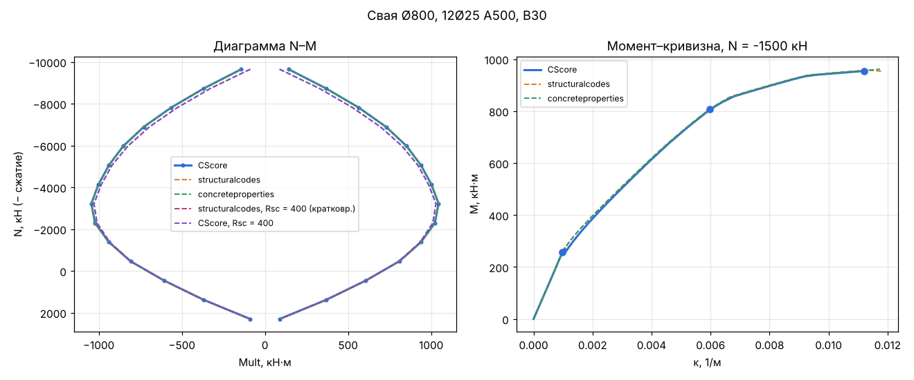
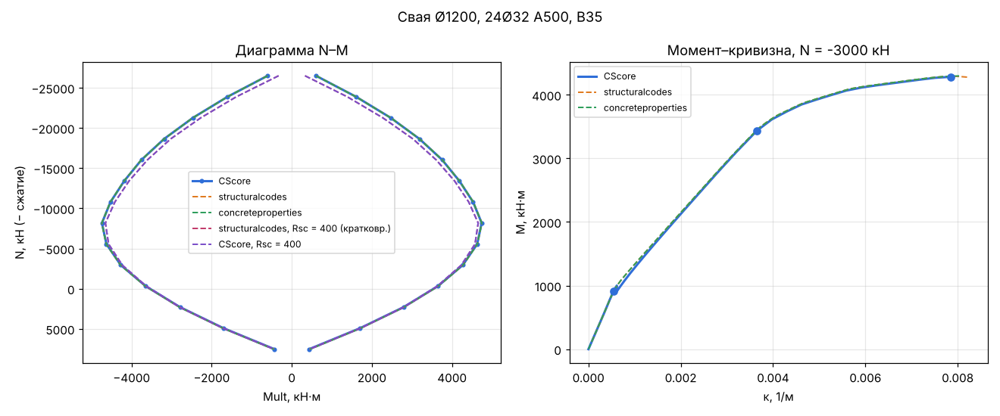
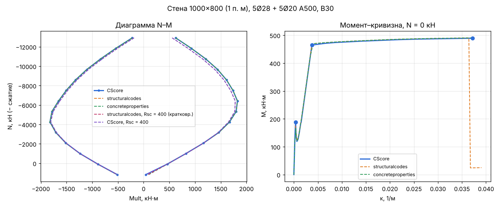
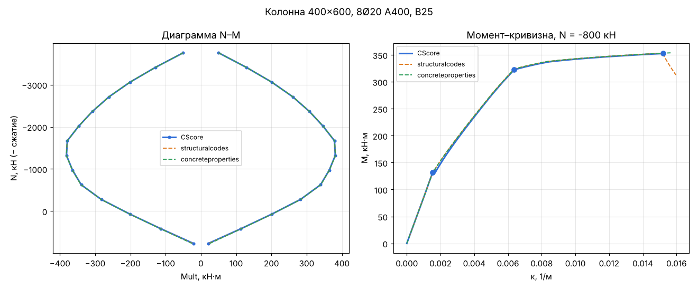

# Сверка CScore с независимыми расчётами

Сгенерировано `tools/crosscheck/crosscheck.py`. Одинаковые диаграммы СП 63 (двухлинейный бетон, упругопластическая арматура, εs,u = 0,025) заданы в трёх программах. Отклонение Mult = (CScore − другая) / наибольший Mult кривой другой программы; для M–κ — к величине другой программы.

Запуск: `pip install -r tools/crosscheck/requirements.txt`, `dotnet build src/CScorePileRunner -c Release`, `python tools/crosscheck/crosscheck.py` (около 10 минут; `--only <ключ>` — одно сечение, `--report-only` — отчёт из results.json).

## Таблицы материалов: приложение и structural-materials

Сравнено значений: 68, расхождений: 0.

## Несущая способность и момент–кривизна

| Сечение | ΔMult (N–M): structuralcodes | ΔMult (N–M): concreteproperties | Nc / Nt: CScore и structuralcodes, кН | Mmax M–κ: sc / cp | M в точке текучести: sc / cp |
|---|---|---|---|---|---|
| Свая Ø800, 12Ø25 A500, B30 | макс. 0.2 %, ср. -0.1 % | макс. 0.4 %, ср. -0.1 % | -10158 / 2557; -10158 / 2562 | -0.2 % / -0.7 % | -0.2 % / -0.3 % |
| Свая Ø1200, 24Ø32 A500, B35 | макс. 0.2 %, ср. -0.1 % | макс. 0.5 %, ср. -0.1 % | -27893 / 8374; -27894 / 8396 | -0.2 % / -0.4 % | -0.3 % / -0.2 % |
| Стена 1000×800 (1 п. м), 5Ø28 + 5Ø20 A500, B30 | макс. 2.4 %, ср. -0.1 % | макс. 3.2 %, ср. -0.2 % | -13594 / 1298; -14192 / 2023 | -0.2 % / -0.2 % | +1.4 % / +3.4 % |
| Колонна 400×600, 8Ø20 A400, B25 | макс. 0.5 %, ср. -0.1 % | макс. 1.1 %, ср. -0.2 % | -3954 / 853; -3954 / 855 | -0.1 % / -0.3 % | -0.1 % / +0.1 % |

## Влияние Rsc = 400 МПа при кратковременной нагрузке (табл. 6.14)

Собственная диаграмма арматуры CScore симметрична по Rs; приложение (настройка «Сжатие арматуры по Rsc табл. 6.14») передаёт Rsc, и runner строит расчётную диаграмму со сжатием по Rsc. Изменение Mult при Rsc = 400 МПа (A500) против Rsc = Rs и сверка этой диаграммы CScore со structuralcodes, в долях наибольшего Mult:

| Сечение | Изменение Mult (structuralcodes) | CScore с Rsc против structuralcodes с Rsc |
|---|---|---|
| Свая Ø800, 12Ø25 A500, B30 | до 5.2 %, в среднем -1.8 % | макс. 0.2 %, ср. -0.1 % |
| Свая Ø1200, 24Ø32 A500, B35 | до 5.8 %, в среднем -2.2 % | макс. 0.3 %, ср. -0.1 % |
| Стена 1000×800 (1 п. м), 5Ø28 + 5Ø20 A500, B30 | до 3.7 %, в среднем -1.4 % | макс. 2.4 %, ср. -0.1 % |

## Пояснения

- Бетон под стержнями вычтен во всех трёх программах (в CScore так устроена область арматуры).
- Моменты — относительно геометрического центра сечения, как в CScore. concreteproperties по умолчанию берёт центр приведённого сечения; в стенде он переназначен.
- Nc / Nt: CScore — предел по лучу (N, 0, 0) при M = 0 относительно центра; structuralcodes (`calculate_limit_axial_load`) — сумма полной текучести всех материалов без условия M = 0. При несимметричной арматуре (стена) значения поэтому не совпадают; сравниваются точки N–M.
- Наибольшие отклонения N–M — у вершин кривой (около Nt), где Mult мал; отклонение отнесено к наибольшему Mult.
- M–κ CScore — `BiaxialCurvatureCurveSolver` (команда runner `--moment-curvature`) по расчётным диаграммам (C), без ψs: трещинообразование, текучесть, предел (точки на графике). Провал момента после трещины — выключение растянутого бетона за εbt2, он есть во всех трёх программах. Сравниваются Mmax и M при кривизне текучести CScore.
- Rsc: диаграмма арматуры ядра симметрична по Rs (MaterialChars.D2L); несимметричную расчётную диаграмму (C, CL) строит runner открытыми средствами ядра (Diagramm, Diagramm.Differential).

### Свая Ø800, 12Ø25 A500, B30

### Свая Ø1200, 24Ø32 A500, B35

### Стена 1000×800 (1 п. м), 5Ø28 + 5Ø20 A500, B30

### Колонна 400×600, 8Ø20 A400, B25

