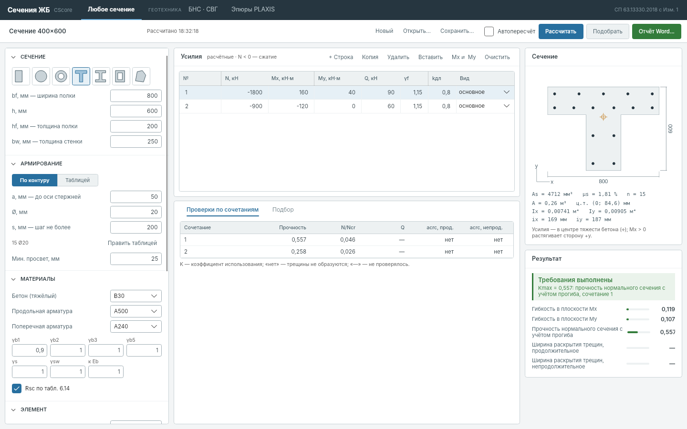
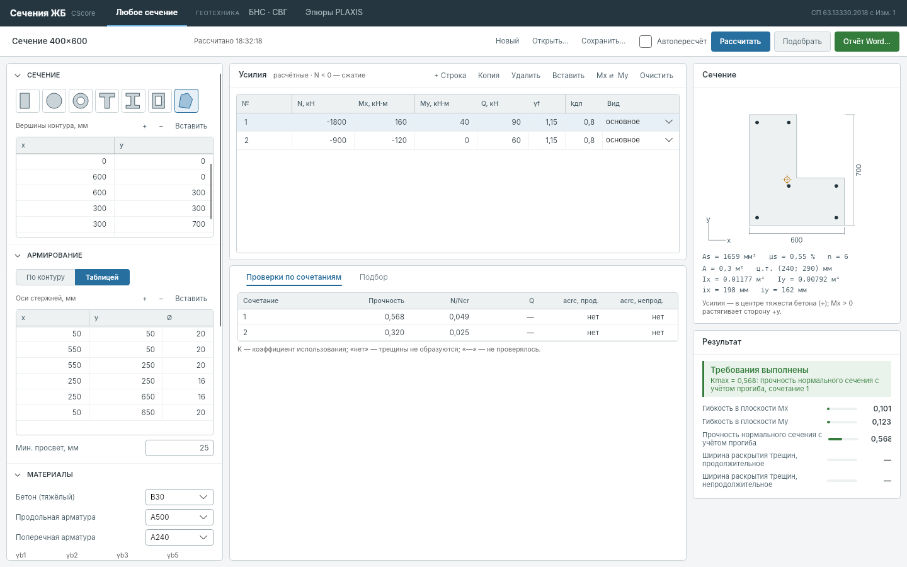

# Сечения ЖБ — настольное приложение

Windows-приложение (`SectionApp.exe`) для проверки и подбора армирования железобетонного
сечения по СП 63. Два режима:

- **Любое сечение** — произвольный контур (шаблон или многоугольник, с отверстиями) и любые
  стержни;
- **Геотехника** — **БНС · СВГ** (буронабивная свая, стена в грунте) и **Эпюры PLAXIS**
  (армирование по длине сваи или стены по усилиям PLAXIS, типизация свай).

Python и браузер не нужны: расчётное ядро CScore встроено в программу.



## Как работать

Окно одно: слева исходные данные, в центре усилия и результаты, справа эскиз и итог.
**Автопересчёт** включён: проверка выполняется сама через полсекунды после любой правки
(проверка сечения занимает доли секунды), кнопка «Рассчитать» (F5) нужна, только если
автопересчёт выключить. Результат до пересчёта показан бледным.

У каждого режима свой проект (название, усилия, параметры): переход между «Любым
сечением» и «БНС · СВГ» не смешивает их. Внутри «БНС · СВГ» переключатель **БНС / СВГ**
меняет только геометрию, усилия остаются.

### Исходные данные

Колонка свойств: слева величина с единицей, справа значение. Редко нужные группы свёрнуты;
группа «Сейсмика и особые сочетания» раскрывается сама, когда в таблице появляется такое
сочетание, группа «Поперечная сила Q» — галочкой в её заголовке.

- **Сечение** (любое) — шаблон: прямоугольник, круг, кольцо, тавр (полка сверху),
  двутавр, коробка — или **многоугольник** по вершинам. Вершины вводятся в таблице или
  вставляются из Excel / списка координат AutoCAD (строки «x y», кнопка «Вставить»).
  Самопересечение контура и стержень вне бетона сообщаются сразу.
- **Армирование** (любое) — **По контуру**: стержни в углах контура, смещённого внутрь на a
  (до оси), и промежуточные с шагом не более s; у отверстий — так же; стенка кольца или
  коробки, в которую не помещаются два ряда, получает один ряд по середине. **Таблицей**:
  x, y, Ø каждого стержня (вставка «x y [Ø]» из Excel). «Править таблицей» переносит
  расстановку по контуру в таблицу, чтобы сдвинуть или удалить отдельные стержни.
- **Сечение БНС** — D, число и Ø стержней, Ø навивки, защитный слой и от чего он
  отсчитывается: до стержней в свету (как a1 в АРБАТ, по умолчанию), до спирали/хомута
  (прежние файлы) или до оси. Под полем — расстояние до оси стержней.
- **Сечение СВГ** — ширина b (вдоль стены), толщина h, стержни граней «+» и «−» (n × Ø;
  грань «+» растянута при Mx > 0), 1–3 ряда у грани с зазором в свету, Ø хомута, защитный слой.
- **Материалы** — бетон (тяжёлый), продольная и поперечная арматура, γb1 (0,9; в
  кратковременных сочетаниях 1), γb2, γb3, γb5, γs, γsw, коэффициент к Eb, Rsc по табл. 6.14.
- **Элемент** — L, μx / μy (l₀ = μL), предельная гибкость, статическая схема, случайный
  эксцентриситет (0 — по СП 63, заданный — не менее 10 мм, или «учтён в моментах»), прогиб
  (η по п. 8.1.15, учтено в усилиях, не учитывать), γn по прочности и по трещиностойкости.
- **Трещины** — категория, требование (сохранность арматуры 0,3/0,4 мм или проницаемость
  0,2/0,3 мм), пределы и ψs: **консервативный** (по умолчанию; σs,crc по сечению без трещин
  при M = Mcrc, в запас, сверен с АРБАТ) или **уточнённый**. При kдл < 1 — схема п. 8.2.6:
  acrc = acrc,1 + acrc,2 − acrc,3.
- **Поперечная сила Q** — шаг, число рабочих ветвей и Ø хомутов (любое сечение, СВГ) или
  a для h0 (БНС: b = 0,885D, h0 = b − a), подтверждение конструктивных требований, момент в
  наклонном сечении (8.63). В любом сечении ядро само находит b — наименьшую ширину в пределах
  h0 — и h0 по растянутым стержням; Q круга и кольца в этом режиме не проверяется (для сваи —
  режим «БНС · СВГ»).
- **Сейсмика и особые сочетания** — m_tr по СП 14 табл. 5.4, трещины при сейсмике (п. 5.18);
  особые по СП 296 — нормативные или расчётные характеристики, коэффициенты.

### Усилия

Таблица как в АРБАТ: №, N, Mx, My, Q, γf, kдл и **вид** сочетания одним списком: основное,
кратковременное, сейсмическое (в т. ч. кратковременное), особое. N < 0 — сжатие.
Нормативные (для трещин) = расчётные / γf, длительные = kдл × нормативные; kдл задаёт и
долю длительной нагрузки для η. «+ Строка» берёт γf, kдл и вид выбранной строки; Delete
удаляет строку; Ctrl+V или «Вставить» — строки из Excel ([№] N Mx My Q [γf] [kдл],
заголовки пропускаются); «Mx ⇄ My» — смена силовой плоскости.

В любом сечении усилия приложены в **центре тяжести бетона** (на эскизе ✛): координаты
можно вводить в любой системе, программа сама переносит их в центр тяжести. Mx > 0
растягивает сторону +y. Под эскизом — A, центр тяжести, Ix, Iy, радиусы инерции; по ним
считаются гибкость и случайный эксцентриситет (h — габарит сечения в плоскости момента).

### Результаты

- **Проверки по сочетаниям** — K по видам проверок (прочность, N/Ncr, Q, трещины), K > 1
  красным; справа итог и наибольший K каждой проверки.
- **Подбор** — БНС: диапазон числа стержней и диаметры; СВГ: число стержней на грани
  (одинаково или раздельно) и диаметры; любое сечение: диаметры при тех же положениях
  стержней, а при расстановке по контуру ещё и шаги s. Варианты проверяются полным расчётом
  от лёгкого к тяжёлому; первый прошедший — самый лёгкий. «Принять» переносит вариант в
  сечение и пересчитывает.
- **Отчёт Word…** — расчётная записка: исходные данные (для любого сечения — контур,
  геометрические характеристики, координаты стержней), материалы и сопротивления по видам
  сочетаний, усилия, результаты, расчёт определяющих сочетаний по формулам с подстановкой
  (гибкость, ea, η, прочность по деформационной модели, Q по 8.55 и 8.56, трещины), подбор.
- **Сохранить / Открыть** — файлы `*.section.json` версии 2 (только исходные данные; в файле
  хранится геометрия всех видов сечения).

Примеры: `examples/profile/bns-800.section.json`, `svg-600.section.json`,
`tavr-700.section.json` и отчёты `report-bns.docx`, `report-svg.docx`, `report-custom.docx`.




### Виды сочетаний

| Вид | Прочность (сопротивления) | γn | Трещины |
|---|---|---|---|
| Основное | γb1 · γb2 · γb3 · γb5 к Rb, γb1 к Rbt, γs к Rs, Rsw | да | да |
| Кратковременное | то же, γb1 = 1 | да | да |
| Сейсмическое | дополнительно m_tr (нормальные 1,2, наклонные 1,0) | да | по флажку |
| Особое | нормативные (Rb,n, Rbt,n, Rs,n, 1,15·Rsw) или расчётные × коэф. СП 296 × понижающий | нет | нет |

Снижение ξR при сейсмике (СП 14 п. 6.7.2) в нелинейной деформационной модели не применяется:
прочность определяется предельными деформациями. Трещины проверяются, только если все
проверки прочности выполнены; нормативные усилия берутся без ea и η.

## Что считается

Все сопротивления, η, трещины и Q вычисляет закреплённое ядро CScore (OpenCS `4ae6aa0`
с исправлением φn). Приложение собирает тот же запрос к ядру, что и проверенная ручная
проверка workbench: это подтверждено тестом сравнения запросов (`tests/SectionCalc.Tests`).
Методика трещин — основной режим `arbat_conservative`, SLS без ea и η, разделение
длительной и полной нагрузки по п. 8.2.6
([сверка](research/arbat-seven-full-2026-10-19.md), [эталоны](research/crack-benchmarks-2026-10-19.md)).

Материалы — СП 63.13330.2018 с Изм. 1 (табл. 6.13, 6.14: A400 Rs = 340, Rs,n = 390).
Сжатие арматуры — по Rsc табл. 6.14 (вкладка «Материалы», галочка «Сжатие арматуры по Rsc
табл. 6.14», включена по умолчанию): A500 — 435 МПа, в кратковременных сочетаниях 400 МПа.
Собственная диаграмма арматуры ядра симметрична по Rs; расчётную диаграмму со сжатием по Rsc
строит runner средствами ядра, само ядро не меняется. Без галочки Rsc = Rs (как в АРБАТ по
умолчанию). Влияние — до 4–6 % Mult в зоне большого сжатия.
Независимая сверка ядра со structuralcodes и concreteproperties (N–M, момент–кривизна) и таблиц
со structural-materials — [docs/crosscheck](crosscheck/README.md): расхождения Mult ≤ 0,5–1 %
для свай и колонны, до 3 % в вершине кривой несимметричной стены.

Произвольный контур передаётся ядру многоугольником с отверстиями (круг — 96 сторон, как
у сваи); сетка волокон та же, что у сваи и стены. Прямоугольник со стержнями стены даёт те же
K, что и режим СВГ (тест `CustomSectionTests`), отверстие снижает предел на сжатие ровно на
свою площадь (тест runner `PolygonSectionTests`).

Не проверяются: анкеровка, стыки, обрывы, конструктивные требования (в том числе
минимальное армирование). Q круглого сечения — принятая инженерная модель
(b = 0,885D, h0 = b − a, виток — две ветви). Результат предварительный.


## Сборка

```sh
dotnet test tests/SectionCalc.Tests/SectionCalc.Tests.csproj
dotnet test tests/SectionApp.Tests/SectionApp.Tests.csproj      # headless UI; SECTION_APP_SCREENSHOTS=папка сохраняет экраны
dotnet publish src/SectionApp/SectionApp.csproj -c Release -r win-x64 --self-contained true -p:PublishSingleFile=true -p:EnableCompressionInSingleFile=true -o publish-app
```

Windows-архив `section-app-windows` собирает workflow «CScore pile PoC Windows».

Состав: `src/SectionCalc` — модель (в т. ч. `CustomSection.cs` — произвольное сечение), таблицы материалов, сборка запроса, вызов ядра в процессе,
подбор, эскиз, отчёт Word; `src/SectionApp` — интерфейс Avalonia 11.
