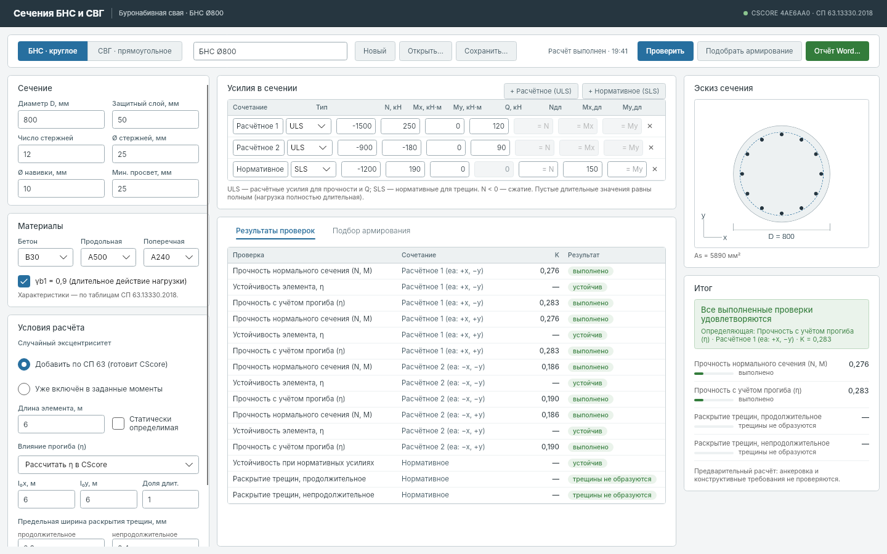
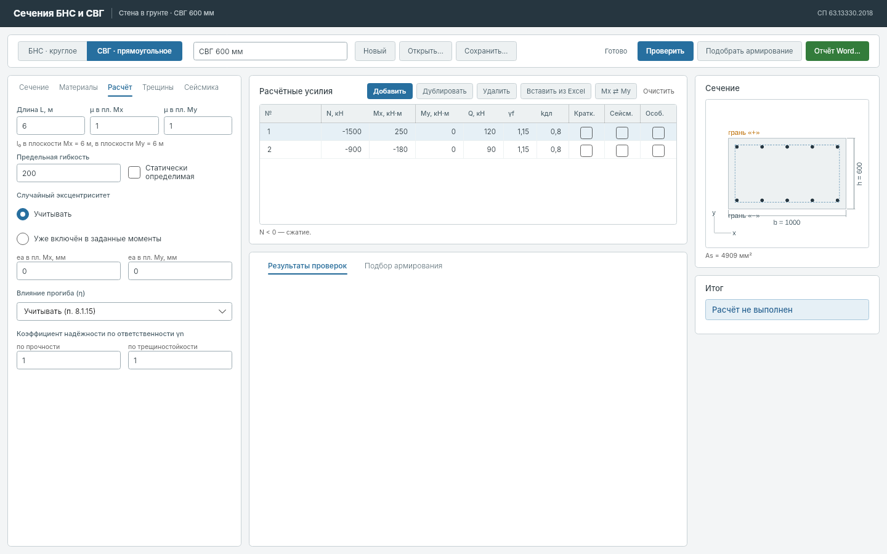
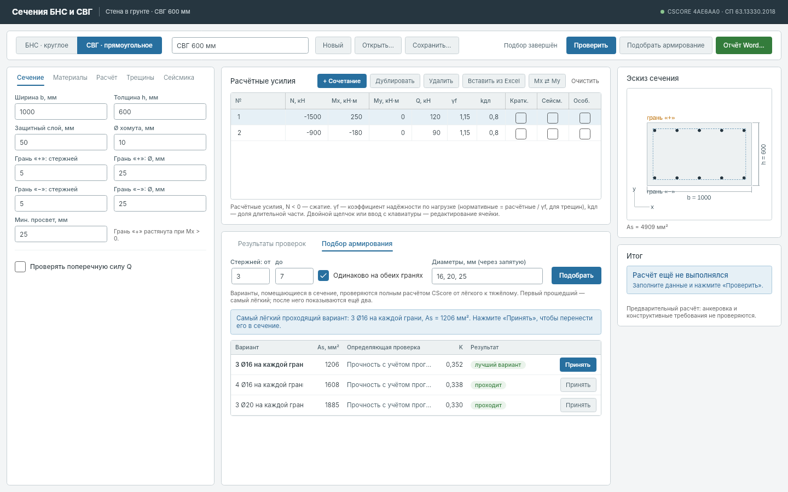

# Сечения БНС и СВГ — настольное приложение

Отдельное Windows-приложение (`SectionApp.exe`) для проверки и подбора армирования
одного сечения буронабивной сваи (круг) или стены в грунте (прямоугольник).
Python и браузер не нужны: расчётное ядро CScore встроено в программу.
Оформление — дизайн-код SoilStiffness.



## Как работать

1. Выберите тип: **БНС · круглое** или **СВГ · прямоугольное**.
2. Исходные данные — на вкладках слева (как в Арбате):
   - **Сечение** — БНС: D, защитный слой до наружной поверхности навивки, число и Ø стержней,
     Ø навивки; СВГ: ширина b, толщина h, защитный слой до хомута, стержни граней «+» и «−»
     (грань «+» растянута при Mx > 0). Здесь же поперечная арматура и проверка Q. Эскиз справа
     обновляется сразу.
   - **Материалы** — класс бетона (тяжёлый), γb1 (0,9; в кратковременных сочетаниях 1),
     γb2, γb3, γb5, коэффициент упрочнения к Eb; классы продольной и поперечной арматуры и
     их коэффициенты условий работы γs.
   - **Расчёт** — длина элемента L, μ в плоскостях Mx и My (l₀ = μL), предельная гибкость,
     статическая схема, случайный эксцентриситет (0 — по СП 63, заданный — не менее 10 мм,
     или «уже в моментах»), учёт прогиба η, γn по прочности и по трещиностойкости.
   - **Трещины** — категория (ограниченное раскрытие или трещины не допускаются), требование
     (сохранность арматуры 0,4/0,3 мм или ограничение проницаемости 0,3/0,2 мм), пределы и
     расчёт ψs: **консервативный** (по умолчанию; σs,crc по сечению без трещин при M = Mcrc,
     в запас, сверен с Арбатом) или **уточнённый** (σs,crc по сечению с трещиной, как в ядре).
     При kдл < 1 оба идут по схеме п. 8.2.6: acrc = acrc,1 + acrc,2 − acrc,3.
   - **Сейсмика** — m_tr для нормальных (1,2) и наклонных (1,0) сечений по СП 14 табл. 5.4,
     проверка трещин при сейсмике (п. 5.18); особые сочетания по СП 296 — нормативные или
     расчётные характеристики, коэффициенты условий работы и понижающий коэффициент.
3. **Расчётные усилия** — таблица как в Арбате: №, N, Mx, My, Q, γf, kдл и признаки
   «Кратк.», «Сейсм.», «Особ.». N < 0 — сжатие. Нормативные усилия (для трещин) = расчётные / γf,
   длительные = kдл × нормативные; kдл также задаёт долю длительной нагрузки для η.
   Кнопки: добавить (с γf, kдл и признаками выбранной строки), дублировать, удалить (Delete),
   **Вставить из Excel** (Ctrl+V: столбцы [название] N Mx My Q [γf] [kдл], заголовки пропускаются),
   **Mx ⇄ My** — смена силовой плоскости.
4. **Проверить** (F5): таблица K по сочетаниям (прочность, N/Ncr, Q, трещины; худший знак ea)
   и итог справа.
   При изменении данных результаты помечаются устаревшими.
5. **Подбор армирования**: задайте диапазон числа стержней и диаметры, нажмите
   «Подобрать». Варианты проверяются полным расчётом от лёгкого к тяжёлому; первый
   прошедший — самый лёгкий. «Принять» переносит вариант в сечение и пересчитывает.
6. **Отчёт Word…** — расчётная записка: исходные данные (сечение, материалы с коэффициентами,
   расчётные сопротивления по видам сочетаний, параметры, усилия), результаты (определяющие
   проверки и таблица K по сочетаниям) и расчёт определяющих сочетаний по формулам с
   подстановкой: гибкость, случайный эксцентриситет, η (Ncr), прочность по деформационной
   модели (kult и предельные усилия), Q по 8.55 и 8.56 (qsw, C, Qsw, Qb), образование
   трещин (Mcrc) и ширина раскрытия (σs, σs,crc, ψs, ls, acrc,1…3). Затем подбор и примечания.
7. **Сохранить/Открыть** — файлы `*.section.json` версии 2 (результаты не хранятся, только
   исходные данные). Файлы версии 1 (усилия ULS/SLS) не открываются — сечение вводится заново.

Примеры: `examples/section-app/bns-800.section.json`, `svg-600.section.json`,
образцы отчётов `report-bns.docx`, `report-svg.docx`.

### Виды сочетаний

| Вид | Прочность (сопротивления) | γn | Трещины |
|---|---|---|---|
| Основное | γb1 · γb2 · γb3 · γb5 к Rb, γb1 к Rbt, γs к Rs, Rsw | да | да |
| Кратковременное | то же, γb1 = 1 | да | да |
| Сейсмическое | дополнительно m_tr (нормальные 1,2, наклонные 1,0) | да | по флажку |
| Особое | нормативные (Rb,n, Rbt,n, Rs,n, 1,15·Rsw) или расчётные × коэф. СП 296 × понижающий | нет | нет |

Снижение ξR при сейсмике (СП 14 п. 6.7.2) в нелинейной деформационной модели не применяется:
прочность определяется предельными деформациями. Трещины проверяются, только если все
проверки прочности выполнены; нормативные усилия берутся без ea и η.

## Что считается

Все сопротивления, η, трещины и Q вычисляет закреплённое ядро CScore (OpenCS `4ae6aa0`
с исправлением φn). Приложение собирает тот же запрос к ядру, что и проверенная ручная
проверка workbench: это подтверждено тестом сравнения запросов (`tests/SectionCalc.Tests`).
Методика трещин — основной режим `arbat_conservative`, SLS без ea и η, разделение
длительной и полной нагрузки по п. 8.2.6
([сверка](research/arbat-seven-full-2026-10-19.md), [эталоны](research/crack-benchmarks-2026-10-19.md)).

Не проверяются: анкеровка, стыки, обрывы, конструктивные требования (в том числе
минимальное армирование). Q круглого сечения — принятая инженерная модель
(b = 0,885D, h0 = b − a, виток — две ветви). Результат предварительный.





## Сборка

```sh
dotnet test tests/SectionCalc.Tests/SectionCalc.Tests.csproj
dotnet test tests/SectionApp.Tests/SectionApp.Tests.csproj      # headless UI; SECTION_APP_SCREENSHOTS=папка сохраняет экраны
dotnet publish src/SectionApp/SectionApp.csproj -c Release -r win-x64 --self-contained true -p:PublishSingleFile=true -p:EnableCompressionInSingleFile=true -o publish-app
```

Windows-архив `section-app-windows` собирает workflow «CScore pile PoC Windows».

Состав: `src/SectionCalc` — модель, таблицы материалов, сборка запроса, вызов ядра в процессе,
подбор, эскиз, отчёт Word; `src/SectionApp` — интерфейс Avalonia 11.
